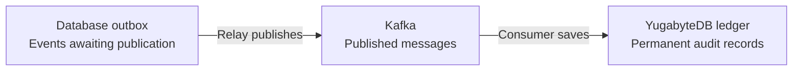

# Audit delivery

Tack saves audit evidence as events in database outboxes, queues of events
awaiting publication. A relay publishes these events to Apache Kafka. A consumer
reads Kafka messages and writes permanent audit records to Tack's ledger in
YugabyteDB. Both processes run in `audit-consumer`.

## Publication and recording

Publication occurs when Kafka accepts an audit event. A consumer records that
event permanently when it commits a ledger record in YugabyteDB.

Outboxes in FoundationDB and YugabyteDB retain events until Kafka acknowledges
publication. Tack waits for acknowledgment from every Kafka replica that
currently keeps a synchronized copy. Outboxes retain events for retry when
publication fails.

An event keeps its identifier across retries. Consumers save each identifier
and its ledger record in one database transaction. If that transaction fails
to commit, consumers do not save either item. Consumers skip identifiers they
have already recorded, even if Kafka delivers an event again.

## Record order and integrity

A hash chain is an ordered sequence of audit records that links each record to
its predecessor. Tack divides each organization's audit history into separate
sequences called shards. Every record stores a calculated value, or hash, that
depends on its contents and the preceding record's hash.
Verification checks these links to detect changes to recorded history.

Kafka assigns messages to a partition by organization and shard. A partition is an
ordered sequence of messages. Consumers in one group divide these partitions
among themselves.

A chain head stores the sequence number and hash of the latest ledger record.
When appending a record, consumers check and update its chain head. If another
writer has advanced that head, they retry their batch using its new value.

For events that fit in one message, consumers also save their position in the
Kafka partition, called a delivery offset, in the same ledger transaction.
Consumers stop and retry a batch if they lose their connection.

Consumers save rejected messages and their rejection reasons in a dead-letter
table for investigation instead of appending them to the ledger.

## Events split into parts

Large events are audit events that require several Kafka messages. A manifest
identifies which parts make up each event. Consumers save received
parts and delivery offsets together, then verify and reconstruct the event after
every required part arrives. Consumers retain incomplete events while required
parts are missing. Consumers do not append a partial event to the ledger.

Consumers write each permanent record and remove its temporary parts in one
transaction. They retain those parts for retry if that transaction
does not commit.
