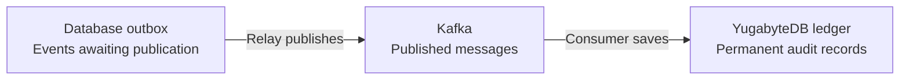

# Audit delivery

Tack saves audit evidence as events in database outboxes, queues of events
awaiting publication. A relay publishes these events to Apache Kafka. A consumer
reads Kafka messages and saves the audit ledger, Tack's permanent audit records
in YugabyteDB. Both the relay and consumer run in the `audit-consumer` service.

## Publication and recording

Outboxes in FoundationDB and YugabyteDB retain events until Kafka acknowledges
publication. Tack waits for acknowledgment from every Kafka replica that
currently keeps a synchronized copy. Publication failures leave events in the
outbox for retry. Kafka acknowledgment confirms publication, not permanent
ledger recording.

Retries preserve the event identifier. When saving an event, the consumer stores
its identifier and ledger record in one database transaction, which saves both
or neither. If the consumer has already recorded an identifier, it does not
append another ledger record for that event, even if Kafka delivers it again.

## Record order and integrity

Tack divides each organization's audit history into shards, separate sequences
of records. Each sequence forms a hash chain: every record stores a calculated
value, or hash, that depends on its contents and the preceding record's hash.
Verification checks these links to detect changes to recorded history.

Kafka uses the organization and shard to assign messages to a partition, an
ordered sequence of messages. Consumers in one group divide these partitions
among themselves.

A chain head stores the sequence number and hash of the latest ledger record.
Consumers check that the head has not changed when they append a record and
update the head. If another writer has advanced it, the consumer retries its
batch against the updated head.

For events that fit in one message, a ledger transaction also saves the delivery
offset, the consumer's position in the Kafka partition. A connection failure
stops the batch for retry.

Consumers save rejected messages and their rejection reasons in a dead-letter
table for investigation instead of appending them to the ledger.

## Events split into parts

Large events use several messages. A manifest identifies the parts needed to
reconstruct the event. Consumers save received parts and delivery offsets
together, then verify and reconstruct the event after every required part
arrives. Missing parts leave the saved event incomplete; the consumer does not
append a partial event to the ledger.

Consumers save the permanent record and remove its temporary parts in one
transaction. A failure before that transaction commits leaves the saved parts
available for retry.
